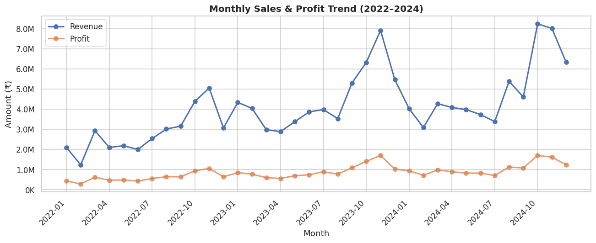
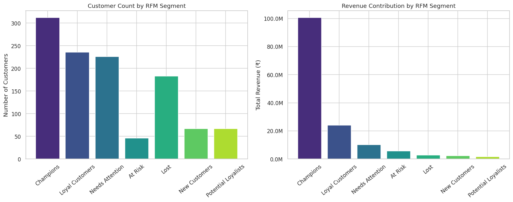
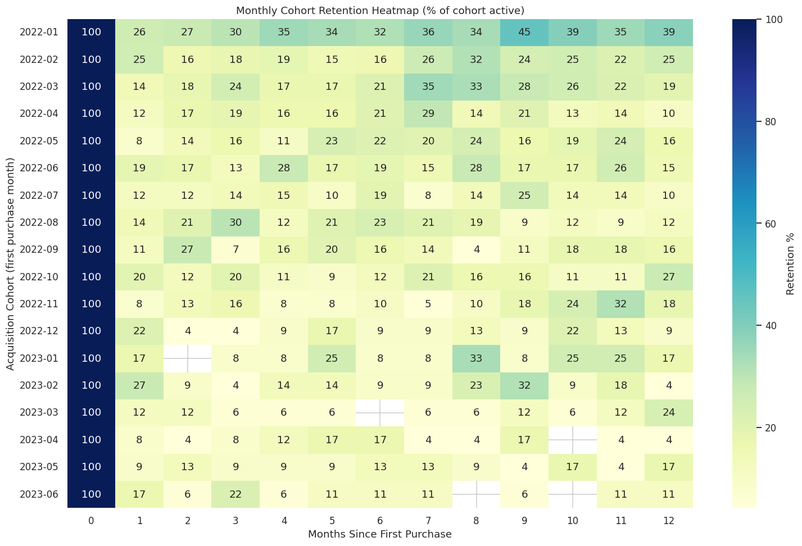
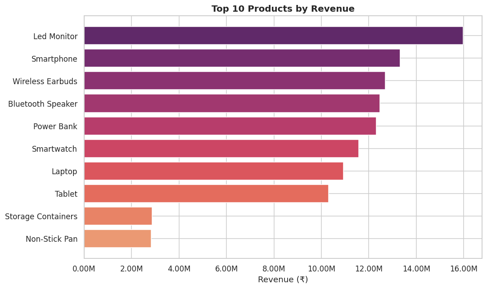
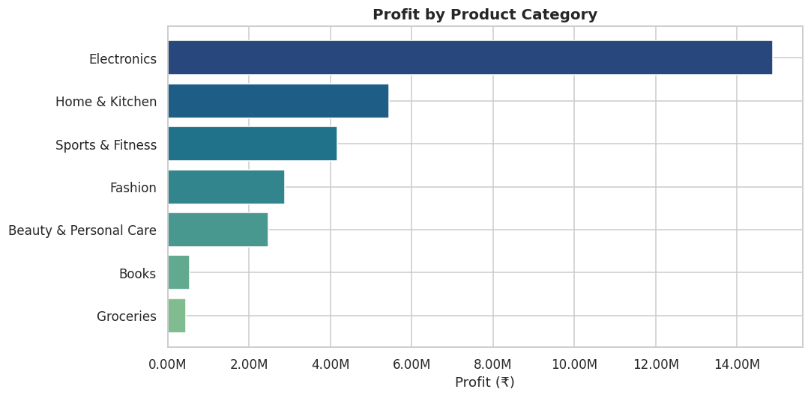
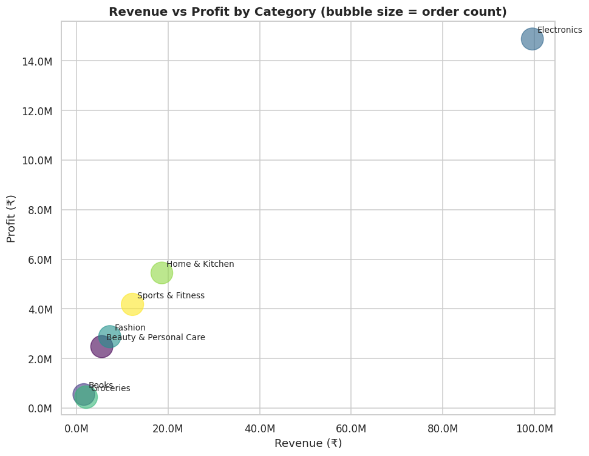

# 🛒 E-Commerce Customer Analytics Dashboard

A complete, end-to-end data analytics project covering **data cleaning,
feature engineering, SQL business analysis, Python statistical analysis
(RFM & cohort), and Power BI dashboard design** — built on a realistic
synthetic e-commerce dataset (2022–2024, ~12,000 orders, 1,137 customers).

This project was built as a **Data Analyst portfolio piece** to demonstrate
the full analytics workflow used in real business settings: from messy raw
data to clean datasets, to SQL/Python analysis, to a presentation-ready BI
dashboard and a stakeholder-facing report.

---

## 📌 Project Objective

Analyze e-commerce sales and customer behavior data to surface **sales
trends, customer segments, top-performing products, and revenue growth
opportunities** — and translate those findings into concrete business
recommendations.

---

## 🧰 Tech Stack

| Layer | Tools |
|---|---|
| Data wrangling | Python, Pandas, NumPy |
| Analysis | Jupyter Notebook, SQL (window functions, CTEs) |
| Visualization | Matplotlib, Seaborn, Power BI |
| Dataset | Synthetic CSV (17 columns, generated with Faker for realism) |

---

## 📊 Headline Results

| Metric | Value |
|---|---|
| **Total Revenue** | ₹1.47 Cr+ (₹146.8M) over 3 years |
| **Total Profit** | ₹30.9M (21.0% margin) |
| **Total Orders** | 11,978 |
| **Total Customers** | 1,137 |
| **Average Order Value** | ₹12,258.65 |
| **Repeat Purchase Rate** | 86.2% |
| **Revenue Growth (2023)** | +60.0% YoY |
| **Top Customer Segment (Champions)** | 27.4% of customers → **68.5% of revenue** |

> 📄 Full findings and business recommendations: [`reports/Project_Report.md`](reports/Project_Report.md)

---

## 🗂️ Repository Structure

```
ECommerce-Customer-Analytics/
│
├── data/
│   ├── generate_dataset.py        # Synthetic raw data generator (Faker-based)
│   ├── ecommerce_raw.csv          # Raw, intentionally messy dataset
│   ├── ecommerce_clean.csv        # After cleaning (01_data_cleaning.ipynb)
│   ├── ecommerce_features.csv     # After feature engineering (02_*.ipynb)
│   ├── customer_features.csv      # Customer-level aggregates
│   ├── customer_rfm.csv           # RFM scores & segments
│   └── cohort_retention_table.csv # Cohort retention matrix
│
├── notebooks/
│   ├── 01_data_cleaning.ipynb           # Missing values, duplicates, dates, text, validation
│   ├── 02_feature_engineering.ipynb     # Month/Quarter/Year, CLV, AOV, Profit Margin
│   ├── 03_exploratory_analysis.ipynb    # Revenue/product/customer charts (8 visuals)
│   └── 04_rfm_cohort_analysis.ipynb     # RFM segmentation, cohort retention, advanced KPIs
│
├── sql/
│   ├── schema.sql                 # Table schema + indexes
│   └── analysis_queries.sql       # 8 core + 5 bonus business queries
│
├── dashboard/
│   ├── PowerBI_Design_Spec.md     # Full 4-page dashboard layout & visual spec
│   └── DAX_Measures.txt           # All DAX measures (KPIs, time intelligence, retention)
│
├── reports/
│   ├── Project_Report.md          # Stakeholder-facing findings & recommendations
│   └── kpi_summary.csv            # Final KPI values
│
├── images/                        # All exported charts (PNG)
│
├── README.md
└── requirements.txt
```

---

## 🔍 What's Inside Each Stage

### 1️⃣ Data Cleaning (`01_data_cleaning.ipynb`)
The raw dataset is **intentionally messy** to mirror a real production
export: 3 mixed date formats, ~150 duplicate rows, inconsistent text casing
(`"MUMBAI"` / `"mumbai "` / `"Mumbai"`), missing `Age`/`Discount`/
`Customer_Name`/`City` values, and a few invalid numeric entries (negative
quantities, zero prices). Every fix is documented with its rationale —
not just applied silently.

### 2️⃣ Feature Engineering (`02_feature_engineering.ipynb`)
Derives `Month`, `Quarter`, `Year`, `Profit_Margin`, `Customer_Lifetime_Value`,
`Average_Order_Value`, `Revenue_per_Customer`, and `Customer_Tenure_Days`,
producing both an enriched order-level table and a customer-level summary
table.

### 3️⃣ SQL Analysis (`sql/analysis_queries.sql`)
13 validated queries (tested against the real dataset via SQLite) covering:
top customers, top products, monthly trends with growth %, region-wise
sales, profit analysis with margin %, retention analysis, AOV, category
performance scorecards, YoY growth, basket size, payment distribution,
state-wise sales, and per-category product ranking with `RANK() OVER()`.

### 4️⃣ Python Analysis — RFM & Cohorts (`04_rfm_cohort_analysis.ipynb`)
- **RFM Analysis:** customers scored on Recency/Frequency/Monetary and
  segmented into 7 groups (Champions, Loyal Customers, At Risk, Lost, etc.)
- **Cohort Analysis:** monthly acquisition cohorts tracked for 18 months,
  visualized as a retention heatmap
- **Advanced KPIs:** Revenue Growth %, Profit Margin %, Retention Rate,
  Average Basket Size, Repeat Purchase Rate

### 5️⃣ Power BI Dashboard (`dashboard/`)
A complete, build-ready 4-page dashboard specification:
- **Page 1 – Executive Overview:** KPI cards + monthly trend, region, category charts
- **Page 2 – Customer Analytics:** RFM segmentation, CLV, repeat vs new customers, cohort heatmap
- **Page 3 – Product Analytics:** top products/categories, profitability matrix
- **Page 4 – Regional Analytics:** state-wise sales, region profit, interactive map

All DAX measures are pre-written in `DAX_Measures.txt` — paste-ready into Power BI Desktop.

---

## 📈 Sample Visualizations

| Monthly Sales & Profit Trend | RFM Customer Segmentation |
|---|---|
|  |  |

| Cohort Retention Heatmap | Top 10 Products by Revenue |
|---|---|
|  |  |

| Profit by Category | Revenue vs Profit (Category Bubble Chart) |
|---|---|
|  |  |

*(All 10 charts available in `/images`.)*

---

## 🚀 How to Run This Project

```bash
# 1. Clone the repository
git clone https://github.com/<your-username>/ECommerce-Customer-Analytics.git
cd ECommerce-Customer-Analytics

# 2. Install dependencies
pip install -r requirements.txt

# 3. (Optional) Regenerate the raw dataset
python data/generate_dataset.py

# 4. Run the notebooks in order
jupyter notebook notebooks/01_data_cleaning.ipynb
jupyter notebook notebooks/02_feature_engineering.ipynb
jupyter notebook notebooks/03_exploratory_analysis.ipynb
jupyter notebook notebooks/04_rfm_cohort_analysis.ipynb

# 5. Run SQL queries against ecommerce_features.csv
#    (load into MySQL/PostgreSQL/SQLite using sql/schema.sql, then run
#     sql/analysis_queries.sql)

# 6. Build the Power BI dashboard
#    Open Power BI Desktop → import the CSVs in /data per
#    dashboard/PowerBI_Design_Spec.md → paste DAX measures from
#    dashboard/DAX_Measures.txt
```

---

## 💡 Key Business Insights

1. **A small segment drives most revenue** — "Champions" (27.4% of
   customers) generate 68.5% of total revenue, highlighting the value of
   loyalty-focused retention strategy.
2. **Electronics dominates revenue but has the thinnest margin** (14.9% vs.
   21% company average) — a category mix-shift toward Fashion/Beauty
   (39–45% margins) could lift overall profitability.
3. **Revenue growth is decelerating** (+60% in 2023 → +9.5% in 2024),
   signaling a shift from acquisition-led to retention-led growth strategy.
4. **Retention drops sharply in the first month** post-acquisition —
   a targeted "second purchase" campaign in the first 60 days is the
   highest-leverage retention lever identified.

Full analysis: [`reports/Project_Report.md`](reports/Project_Report.md)

---

## 📝 Resume Bullet Points

> See [`reports/Resume_Bullet_Points.md`](reports/Resume_Bullet_Points.md)
> for ATS-friendly, quantified resume bullets generated from this project.

---

## 👤 Author

**Kshitij Dakhera**
B.Tech Information Technology (2023–2027) | Full-Stack Developer & Data Analytics Enthusiast
📍 Jaipur, Rajasthan, India

---

## 📄 License

This project uses a synthetic dataset created for educational/portfolio
purposes. Feel free to fork, adapt, and reuse for your own learning or
portfolio — attribution appreciated but not required.
